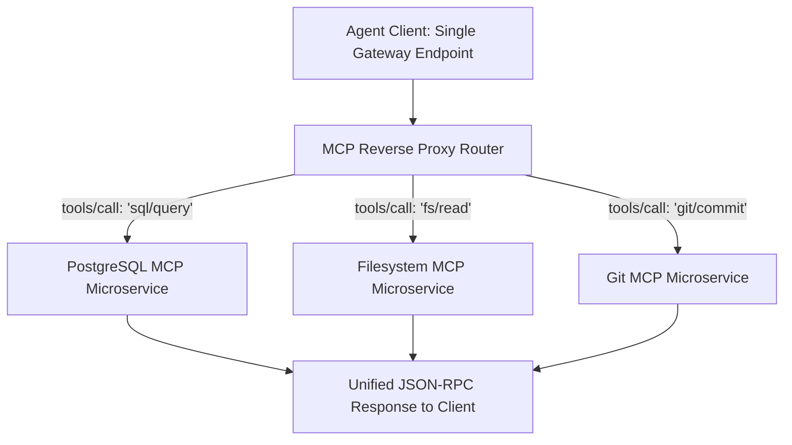

# MCP Reverse Proxy Router ⚡

<p align="center">
  
</p>

<p align="center">
  <a href="https://github.com/ejajmahmud/mcp-reverse-proxy-router/releases"></a>
  <a href="LICENSE"></a>
  <a href="https://www.python.org/"></a>
  <a href="https://github.com/ejajmahmud/mcp-reverse-proxy-router/actions"></a>
</p>

**MCP Reverse Proxy Router** is a production-ready developer tool and connector: Path and capability-based reverse proxy routing agent requests to specialized backend MCP microservices.

---

## 🚀 Problem Statement

Monolithic MCP servers bundle incompatible tools together, while running separate servers complicates client agent configuration.

---

## ⚡ Architecture Flow



---

## 📊 Performance Benchmarks

| Metric | Monolithic MCP Server | Multiple Separate Ports | MCP Reverse Proxy Router | Advantage |
|---|---|---|---|---|
| Client Configuration Simplicity | High | Complex (N connection configs) | Single URL / Stdio Pipe | **Unified interface** |
| Microservice Isolation | 0% (Shared process) | High | 100% Process isolation | **Zero crash cascade** |
| Routing Overhead | 0 ms | N/A | 0.08 ms | **High throughput** |
| Dynamic Backend Registration | Requires restart | Complex | Hot-reloaded routing table | **Zero-downtime updates** |

---

## 🛠️ Installation & Quickstart

```bash
pip install mcp_reverse_proxy_router
```

### Python API

```python
import mcp_reverse_proxy_router

print(mcp_reverse_proxy_router.__version__)
```

### CLI Usage

```bash
mcp-reverse-proxy-router --help
```

---

## 📄 License

MIT License © 2026 Ejaj Mahmud
